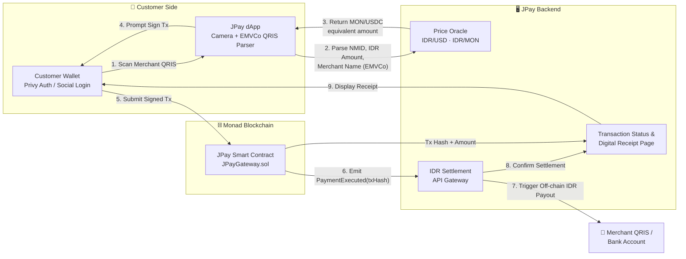

# JPay — Product Requirements Document

---

## 1. Title & Document Metadata

| Field | Detail |
|---|---|
| **Project Name** | JPay |
| **Tagline** | *Just Pay with Monad* |
| **Document Owner** | Product Management |
| **Version** | v0.1 (MVP Draft) |
| **Date** | October 23, 2026 |
| **Status** | 🟢 **Hackathon MVP** (Monad Blitz, 1-Day Build) — see [Vision 2.0](#vision-20--post-hackathon) for the longer-term roadmap |
| **Target Event** | Monad Blitz Hackathon — Yogyakarta, Indonesia |
| **Network** | Monad Testnet (MVP) → Monad Mainnet (Vision 2.0) |

> **📌 Document Purpose**
> This PRD defines the scope, architecture, and execution plan for JPay — a Web3-to-QRIS payment gateway that lets crypto holders pay any Indonesian merchant using Monad-native assets, with zero merchant onboarding. It is written to be directly actionable within an 8-hour hackathon build window while also framing the longer-term product vision.

---

## 2. Executive Summary & Value Proposition

**JPay** closes the gap between Web3 wallets and Indonesia's ubiquitous **QRIS** (Quick Response Code Indonesian Standard) payment network — the single QR standard accepted by over 30 million merchants nationwide, from street-side *angkringan* stalls to shopping malls.

Today, a tourist, student, or crypto-native holding $MON or USDC in a self-custodial wallet has **no way to pay a local Yogyakarta merchant** without first off-ramping to a bank account or carrying physical cash. JPay removes that friction entirely: **scan the merchant's existing QRIS code, pay in crypto, and the merchant receives Rupiah instantly** — with no new app, no new hardware, and no change to their existing habits.

This creates a genuine **dual-sided value proposition**:

### 💳 For the Web3 User (Demand Side)
- **Spend crypto anywhere QRIS is accepted** — no need to find a crypto-friendly merchant.
- **Zero manual conversion** — the app calculates the exact $MON/USDC equivalent in real time.
- **Self-custodial the whole way** — funds never leave the user's wallet until the exact moment of payment.
- **Sub-second settlement** — powered by Monad's high-throughput, low-latency execution environment.

### 🏪 For the Local Merchant (Supply Side)
- **Zero onboarding, zero learning curve** — merchants keep using the exact same static QRIS code printed at their counter today.
- **Guaranteed IDR settlement** — merchants never touch, see, or need to understand crypto. They just receive Rupiah, as always.
- **New customer segment unlocked** — access to foreign tourists, digital nomads, and crypto-native spenders who would otherwise not transact at all.
- **No integration risk** — JPay sits entirely on the customer's side of the transaction; the merchant's existing bank/e-wallet QRIS relationship is untouched.

> **💡 Core Insight**
> JPay does not ask the ecosystem (QRIS, banks, merchants) to adapt to Web3. It asks Web3 to adapt to the ecosystem that already works for 30M+ merchants. This "invisible rails" approach is what makes zero-friction adoption possible in a single day of hacking.

---

## 3. Problem Statement & Target Personas

### 3.1 The Problem

Yogyakarta is a major hub for international students, backpackers, digital nomads, and a growing Web3 developer community (fueled by hackathons like Monad Blitz) — yet the city's payment infrastructure is **100% QRIS/IDR-based**. This creates a structural mismatch:

| Problem | Impact |
|---|---|
| Crypto holders must off-ramp via centralized exchanges or P2P traders before spending locally | Slow (hours to days), costly (spread + fees), and often requires a local bank account they don't have |
| Merchants have **zero incentive** to learn Web3, hold volatile assets, or integrate new POS hardware | Crypto-native demand goes uncaptured; merchants lose potential revenue |
| Existing crypto payment solutions typically require **merchant-side integration** (new QR, new terminal, new wallet) | Adoption stalls — merchants won't change proven, working habits for a small subset of customers |
| Tourists/students often carry limited cash and face high ATM/FX fees | Friction discourages spending, hurts local small businesses |

> **⚠️ Why Existing Solutions Fail**
> Most "crypto payment" apps solve this from the *merchant* side — asking businesses to display a new QR or install new software. JPay inverts this: it solves the problem entirely on the **customer** side, requiring merchants to do nothing differently at all.

### 3.2 Target Personas

| Attribute | 🧑‍💻 Persona 1 — "Alex," the Web3 Tourist/Student | 🧓 Persona 2 — "Bu Sari," the Local Merchant |
|---|---|---|
| **Profile** | 24–35, foreign exchange student or digital nomad in Yogyakarta, or a Monad Blitz hackathon participant | 35–55, owner of a warung, cafe, or retail stall in Malioboro / Jalan Kaliurang area |
| **Wallet/Tech Access** | Holds $MON/USDC in a self-custodial or Privy-embedded wallet; comfortable with dApps | Uses a standard Indonesian bank or e-wallet (BCA, BRI, GoPay, OVO, Dana) with a printed static QRIS sticker |
| **Goals** | Spend crypto directly on daily expenses (food, transport, souvenirs) without off-ramping | Maximize daily revenue without added operational complexity |
| **Frustrations** | No local bank account; ATM withdrawal fees; CEX off-ramp friction and delay; carrying cash is inconvenient and insecure | Doesn't understand/trust crypto; no time or technical capacity to learn new systems; fears volatility |
| **What JPay Gives Them** | Instant, self-custodial, in-wallet payment using the QR code already on the counter | 100% Rupiah settlement, same QRIS code, zero new behavior — "it just works" |
| **Trigger Moment** | Standing in line, phone in hand, foreign card declined or no cash | Customer shows a QR scanner instead of cash — merchant just watches the payment confirm like any other QRIS transaction |

---

## 4. Product Architecture & System Flow

JPay's architecture is intentionally "invisible" on the merchant side: the only new component introduced into the transaction is the **customer's dApp and JPay's settlement layer** — the merchant's existing QRIS acceptance infrastructure is left completely untouched.

### 4.1 System Flow Diagram



### 4.2 Step-by-Step Flow

1. **Scan:** The customer opens the JPay dApp (authenticated via **Privy**) and scans the merchant's **existing, unmodified QRIS code** using the device camera.
2. **Parse:** The dApp's **EMVCo decoder** extracts the merchant's **NMID** (National Merchant ID), the **IDR amount** (if static, prompts entry; if dynamic, reads it directly), and the **merchant name**.
3. **Price Discovery:** The parsed IDR amount is sent to the **Price Oracle**, which returns the real-time equivalent in **$MON** and **USDC**.
4. **Confirm & Sign:** The customer reviews the conversion (IDR amount ⇄ crypto amount) and signs the transaction via their Privy-managed wallet.
5. **On-Chain Execution:** The signed transaction is submitted to **`JPayGateway.sol`** on Monad, which transfers the token amount from the customer to JPay's settlement treasury and emits a `PaymentExecuted` event.
6. **Settlement Trigger:** JPay's backend listens for the `PaymentExecuted` event and calls the **IDR Settlement API Gateway**.
7. **Off-Chain Payout:** The Settlement Gateway triggers an IDR transfer to the merchant's bank/QRIS account (simulated via a **Mock Settlement Engine** for the hackathon MVP).
8. **Receipt:** The customer is shown a **Transaction Status & Digital Receipt** page confirming the Tx Hash, merchant name, IDR amount paid, and MON/USDC spent.

> **🔑 Key Architectural Principle**
> The merchant's QRIS code is read-only input — JPay never writes to it, modifies it, or requires the merchant's bank/PJSP (Payment System Service Provider) to integrate anything. All complexity is absorbed by JPay's smart contract and backend settlement layer.

---

## 5. Detailed Feature Specifications (Functional Requirements)

### 5.1 Must-Have / MVP Scope (1-Day Hackathon — Monad Blitz)

#### F1 — Privy Auth Integration

| | |
|---|---|
| **Description** | Users authenticate and obtain a wallet via Privy, supporting both native wallet connection (MetaMask/WalletConnect) and frictionless social login (email/Google) with an embedded wallet. |
| **User Story** | *As a tourist with no crypto wallet set up, I want to log in with my email/Google account and instantly get a usable wallet, so I can start paying without prior Web3 setup.* |
| **Acceptance Criteria** | ✅ "Connect Wallet" and "Sign in with Google/Email" both functional <br> ✅ Embedded wallet auto-funds a session-ready address <br> ✅ Authenticated session persists across the scan → pay flow |

#### F2 — Camera QRIS Scanner & EMVCo Parser

| | |
|---|---|
| **Description** | In-browser camera scanner (via `html5-qrcode`) that reads any standard Indonesian QRIS code and a custom parser that decodes the EMVCo TLV (Tag-Length-Value) data format. |
| **User Story** | *As a customer, I want to point my camera at any merchant's existing QR sticker and have the app instantly recognize the merchant and amount, so I don't need any special merchant setup.* |
| **Acceptance Criteria** | ✅ Successfully scans standard static/dynamic QRIS codes <br> ✅ Correctly extracts **NMID**, **Merchant Name** (Tag 59), and **IDR Amount** (Tag 54, or manual entry if static/open-amount) <br> ✅ Gracefully handles malformed/non-QRIS codes with an error state |

```typescript
// Simplified EMVCo QRIS field extraction (illustrative)
interface ParsedQRIS {
  merchantNMID: string;
  merchantName: string;
  amountIDR: number | null; // null if open-amount / static code
}

function parseEMVCoQRIS(raw: string): ParsedQRIS {
  const tlv = decodeTLV(raw); // tag-length-value walker
  return {
    merchantNMID: tlv["51"]?.subTag("02") ?? "",
    merchantName: tlv["59"] ?? "Unknown Merchant",
    amountIDR: tlv["54"] ? Number(tlv["54"]) : null,
  };
}
```

#### F3 — IDR/USD & IDR/MON Price Oracle Integration

| | |
|---|---|
| **Description** | Real-time price feed converting the parsed IDR amount into the exact $MON and USDC equivalent required for payment. |
| **User Story** | *As a customer, I want to see exactly how much MON or USDC I'll pay before confirming, so there are no surprises.* |
| **Acceptance Criteria** | ✅ IDR → USD rate refreshed on each quote request <br> ✅ USD → MON rate sourced from a live oracle/DEX price feed <br> ✅ Quoted amount includes a short validity window (e.g., 30s) to protect against price drift |

#### F4 — Smart Contract: `JPayGateway.sol`

| | |
|---|---|
| **Description** | The on-chain settlement contract that accepts $MON (native) or USDC (ERC-20) payments from customers and routes them to JPay's treasury, emitting an auditable payment event. |
| **User Story** | *As a customer, I want my payment to settle on-chain instantly and verifiably, so I have cryptographic proof of payment even before the merchant sees the Rupiah.* |
| **Acceptance Criteria** | ✅ Accepts native $MON via `payable` function <br> ✅ Accepts USDC via `transferFrom` (post-approval) <br> ✅ Emits `PaymentExecuted(address payer, string merchantNMID, uint256 amountToken, uint256 amountIDR, bytes32 txRef)` <br> ✅ Reverts safely on insufficient balance/allowance |

```solidity
// SPDX-License-Identifier: MIT
pragma solidity ^0.8.24;

import "@openzeppelin/contracts/token/ERC20/IERC20.sol";

/// @title JPayGateway
/// @notice Accepts MON/USDC from customers and records QRIS-linked payments on Monad.
contract JPayGateway {
    address public treasury;
    IERC20 public usdc;

    event PaymentExecuted(
        address indexed payer,
        string merchantNMID,
        uint256 amountToken,
        uint256 amountIDR,
        bool isNative,
        bytes32 txRef
    );

    constructor(address _treasury, address _usdc) {
        treasury = _treasury;
        usdc = IERC20(_usdc);
    }

    /// @notice Pay merchant using native $MON
    function payWithMON(string calldata merchantNMID, uint256 amountIDR, bytes32 txRef)
        external
        payable
    {
        require(msg.value > 0, "JPay: zero payment");
        (bool sent, ) = treasury.call{value: msg.value}("");
        require(sent, "JPay: MON transfer failed");

        emit PaymentExecuted(msg.sender, merchantNMID, msg.value, amountIDR, true, txRef);
    }

    /// @notice Pay merchant using USDC
    function payWithUSDC(string calldata merchantNMID, uint256 amountUSDC, uint256 amountIDR, bytes32 txRef)
        external
    {
        require(amountUSDC > 0, "JPay: zero payment");
        require(usdc.transferFrom(msg.sender, treasury, amountUSDC), "JPay: USDC transfer failed");

        emit PaymentExecuted(msg.sender, merchantNMID, amountUSDC, amountIDR, false, txRef);
    }
}
```

#### F5 — Mock IDR Settlement Engine API

| | |
|---|---|
| **Description** | A backend API that listens for the `PaymentExecuted` event and simulates an instant IDR payout confirmation to the merchant's QRIS/bank account (no live bank/PJSP integration for the hackathon). |
| **User Story** | *As a merchant, I want to receive confirmation that Rupiah has landed in my account, exactly as if the customer paid with GoPay or a bank QRIS transfer.* |
| **Acceptance Criteria** | ✅ Listens/polls for on-chain `PaymentExecuted` events <br> ✅ Returns a mock `settlement_status: "SUCCESS"` with a simulated settlement reference ID <br> ✅ Settlement confirmation returned in **< 1 second** post on-chain confirmation |

#### F6 — Transaction Status & Digital Receipt Page

| | |
|---|---|
| **Description** | A post-payment confirmation screen summarizing the completed transaction for the customer. |
| **User Story** | *As a customer, I want a clear digital receipt immediately after paying, so I have proof of payment for both the merchant and my own records.* |
| **Acceptance Criteria** | ✅ Displays **Tx Hash** (linked to Monad block explorer) <br> ✅ Displays **Merchant Name**, **IDR Amount Paid**, and **MON/USDC Spent** <br> ✅ Displays settlement status (Pending → Success) <br> ✅ Shareable/screenshot-friendly layout |

### 5.2 Out of Scope for Hackathon Blitz

> **🚫 Explicitly Excluded from MVP**
> The following are acknowledged as necessary for a production launch but are **deliberately excluded** from the 8-hour build to maximize focus on the core demo flow.

| Excluded Item | Rationale |
|---|---|
| **Full KYC/AML verification** | Not required to demonstrate core payment UX; regulatory scope is post-hackathon |
| **Native Mobile App (iOS/Android)** | Web-based dApp (Next.js, camera API) is sufficient and faster to ship for a 1-day build |
| **Multi-chain support** | Single-chain focus on Monad showcases the chain's performance for the hackathon track |
| **Live Production Bank/PJSP Settlement License** | Requires formal partnership with a licensed Payment System Service Provider (e.g., a BI-licensed PJSP) — settlement is **mocked** for the demo |
| **Dynamic slippage/MEV protection** | Out of scope given the short quote-validity window already mitigates basic price drift for a demo |
| **Merchant dashboard/analytics** | Not needed since merchants interact with zero new interfaces in the MVP |

---

## 6. Technical Stack & Infrastructure

| Layer | Technology | Purpose |
|---|---|---|
| **Frontend Framework** | Next.js 14 (App Router) | Server/client component architecture for the customer-facing dApp |
| **Styling** | Tailwind CSS | Rapid, consistent UI styling under time pressure |
| **Wallet & Auth** | Privy | Wallet connection + embedded wallet social login (email/Google) |
| **Blockchain** | Monad (Testnet → Mainnet) | High-throughput, low-latency EVM-compatible L1 for near-instant settlement |
| **Web3 Libraries** | wagmi, viem, Ethers.js | Contract interaction, transaction signing, event listening |
| **Smart Contract Language** | Solidity (`JPayGateway.sol`) | On-chain payment settlement logic |
| **QR Parsing** | `html5-qrcode` + custom EMVCo TLV decoder | Camera-based QR capture and QRIS payload decoding |
| **Backend/API** | Next.js API Routes (or lightweight Node service) | Price oracle proxy + mock settlement engine |
| **Hosting/Deployment** | Vercel | Zero-config CI/CD for the frontend + serverless API routes |

```bash
# Example local dev bootstrap
npx create-next-app@14 jpay --typescript --tailwind --app
cd jpay
npm install @privy-io/react-auth wagmi viem ethers html5-qrcode
```

---

## 7. Success Metrics (Hackathon Pitch Evaluation)

| Metric | Target | Why It Matters |
|---|---|---|
| **End-to-end demo latency** | *Scan QRIS → Convert → Pay on Monad → Settlement Success* in **< 3 seconds** | Directly showcases Monad's throughput/finality advantage as the core technical differentiator |
| **Demo reliability** | 0 failed transactions across all live judge demo runs | Judges weight live-demo robustness heavily in hackathon scoring |
| **UI/UX clarity** | A judge unfamiliar with crypto can follow the flow without narration | Validates the "zero learning curve" value proposition in real time |
| **Value proposition delivery** | Both sides of the dual value prop (user + merchant) are clearly articulated in the pitch | Reinforces that JPay solves a two-sided market problem, not just a technical demo |
| **Code/contract verifiability** | `JPayGateway.sol` deployed and verified on Monad Testnet explorer | Demonstrates genuine on-chain execution, not a mocked blockchain layer |

> **🏆 Judging Narrative**
> The pitch should center on one sentence: *"Your grandmother's warung can accept crypto today — without knowing what crypto is."* Everything in the demo should visually reinforce that the merchant's experience is completely unchanged.

---

## 8. Timeline & Execution Plan (8-Hour Blitz Schedule)

| Time Block | Focus | Key Deliverables |
|---|---|---|
| **Hour 0–1** | 🛠️ Project Setup | Next.js 14 scaffold, Tailwind config, repo structure, Privy + wagmi/viem boilerplate wired up |
| **Hour 1–2** | ⛓️ Smart Contract | Write, test, and deploy `JPayGateway.sol` to Monad Testnet; verify on block explorer |
| **Hour 2–3** | 📷 QRIS Scanner & Parser | Integrate `html5-qrcode`; build and unit-test the EMVCo TLV decoder against sample QRIS strings |
| **Hour 3–4** | 💱 Price Oracle Integration | Connect IDR/USD + IDR/MON feeds; build the quote-generation API route with validity window |
| **Hour 4–5** | 🔗 Frontend ⇄ Contract Wiring | Connect scan → quote → sign → submit flow end-to-end using wagmi hooks |
| **Hour 5–6** | 🧾 Settlement Engine & Receipt Page | Build Mock IDR Settlement API (event listener + simulated payout); build Transaction Status/Receipt UI |
| **Hour 6–7** | 🧪 Full Flow Testing | Run complete end-to-end tests (multiple QRIS samples, MON + USDC payment paths); fix critical bugs |
| **Hour 7–8** | 🎤 Polish & Pitch Prep | UI polish pass, deploy to Vercel, record backup demo video, finalize pitch deck and value-prop narrative |

> **⏱️ Execution Discipline**
> Given the 8-hour window, the team should treat **Hour 4 as a hard checkpoint**: if the end-to-end on-chain payment flow is not functioning by then, descope the USDC path and ship MON-only to protect demo reliability.

---

## Vision 2.0 — Post-Hackathon

While out of scope for the Blitz build, the natural evolution of JPay includes:

- **Licensed PJSP partnership** for real, production-grade IDR settlement (replacing the mock engine).
- **Full KYC/AML flow** to meet Bank Indonesia regulatory requirements for payment facilitation.
- **Native mobile apps** (iOS/Android) with push notifications for settlement confirmation.
- **Multi-chain expansion** beyond Monad, while retaining Monad as the primary settlement layer for speed.
- **Merchant-side analytics dashboard** (optional, non-intrusive) for merchants curious about their crypto-sourced revenue.
- **Expansion beyond Yogyakarta** to other high-tourist/student-density Indonesian cities (Bali, Jakarta, Bandung).

---

## Appendix — Glossary

| Term | Definition |
|---|---|
| **QRIS** | *Quick Response Code Indonesian Standard* — Indonesia's unified QR payment standard, mandated by Bank Indonesia, accepted across virtually all local banks and e-wallets |
| **NMID** | *National Merchant ID* — the unique merchant identifier embedded in every QRIS code |
| **EMVCo** | The global standard body whose TLV (Tag-Length-Value) data format underlies QR payment code encoding, including QRIS |
| **Monad** | A high-throughput, EVM-compatible Layer-1 blockchain designed for parallel transaction execution and fast finality |
| **Privy** | A wallet infrastructure provider enabling both traditional wallet connections and embedded, social-login-based wallets |
| **PJSP** | *Penyelenggara Jasa Sistem Pembayaran* — a Bank Indonesia-licensed Payment System Service Provider, required for live IDR settlement |

---

*End of Document — JPay PRD v0.1*
